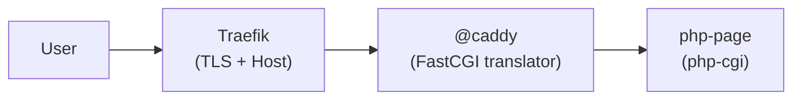

# 06 - Proxy services with Caddy

This checkpoint adds the shared `@caddy` translator and a managed PHP runtime:

- `@caddy` runs the Service Lasso admin API and translates HTTP to FastCGI.
- `php` provides PHP 8.3 (`php-cgi` on Windows, `php-fpm` on POSIX).
- `php-page` runs `php-cgi` with its own document root and declares an `ingress`
  route, so Service Lasso registers it with `@caddy` when it starts.

Traefik remains the public edge (TLS + `Host`). The request path is:



```text
Traefik -> @caddy -> php-cgi (php-page)
```

## Run

```powershell
npm run lesson:06
```

Install, configure and start `php-page` in Service Admin. Then open the
allocated `php-page` domain through Traefik, or `http://127.0.0.1:<CADDY_HTTP_PORT>/`
with `Host: php-page.servicelasso.localhost` locally.

The same page is reachable directly at `php-page`'s `fastcgi` endpoint only via
Caddy, because the endpoint speaks FastCGI rather than HTTP.

## Manifest wiring

`php-page` declares:

```json
"depend_on": ["php"],
"requires": { "php": ">=8.3" },
"ingress": [
  {
    "domain": "php-page.servicelasso.localhost",
    "proxy": {
      "type": "fastcgi",
      "endpoint": "fastcgi",
      "root": "${SERVICE_ROOT}/runtime/www"
    }
  }
]
```

`requires` resolves `php` to the installed PHP provider; `depend_on` pins it.
The `ingress` entry is what triggers the Caddy registration on start and the
unregistration on stop.

See [Advanced - Proxying services with Caddy](https://service-lasso.github.io/service-lasso/getting-started/advanced-proxying-services-with-caddy).
