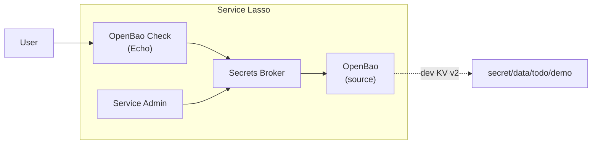

# 7 - Resolve secrets from OpenBao

[Previous](../05-desktop/README.md) | [Repository](../../README.md) | [Article](https://service-lasso.github.io/service-lasso/getting-started/advanced-openbao-secret-source)

This checkpoint adds a development-mode OpenBao source to the Todo learning host. The Secrets Broker reads a mapped ref from OpenBao and delivers it to an Echo consumer. The Todo App/API stack remains available from the previous checkpoint, but this lesson's proof is the OpenBao-to-Broker-to-service boundary.



| Purpose | Service | Responsibility | Seed |
| --- | --- | --- | --- |
| Runtime | [@node](services/@node/service.json) | Run the App and Echo provider | Enabled |
| Runtime | [@python](services/@python/service.json) | Baseline provider | Disabled |
| Runtime | [@java](services/@java/service.json) | Baseline provider | Disabled |
| Certificates | [@localcert](services/@localcert/service.json) | Baseline certificate service | Disabled |
| Routing | [@nginx](services/@nginx/service.json) | Disabled baseline | Disabled |
| Routing | [@traefik](services/@traefik/service.json) | Disabled baseline | Disabled |
| Management | [@serviceadmin](services/@serviceadmin/service.json) | Install, configure and inspect services | Disabled |
| Example | [echo-service](services/echo-service/service.json) | Disabled inherited fixture | Disabled |
| Secrets | [@secretsbroker](services/@secretsbroker/service.json) | Resolve the OpenBao-backed ref | Enabled |
| Source | [@openbao](services/@openbao/service.json) | Development OpenBao KV v2 source | Enabled |
| Consumer | [openbao-check](services/openbao-check/service.json) | Prove the Broker delivered the value | Start explicitly |
| App | [todo](services/todo/service.json) | Serve Todo | Enabled |
| Database | [postgres](services/postgres/service.json) | Retain Todo rows | Enabled |
| API | [todo-api](services/todo-api/service.json) | Own SQL reads and writes | Enabled |

Prerequisites: host Node 22 or newer. The complete managed stack needs macOS 12 or newer because Broker uses Go 1.26. Production use requires an OS still supported by its vendor. The OpenBao service in this checkpoint is a **development-mode** instance with a synthetic root token; it is not a production OpenBao configuration.

From the repository root, with Node 22 or newer:

```sh
npm ci
npm run setup -- 07
npm run lesson:07 -- --management
```

The full-stack proof can also be run non-interactively with `npm run e2e:openbao`.

The setup command creates the isolated `.workspace/07-openbao` services, runtime and registry trees. The management host suppresses autostart so every service start is explicit. The configure command writes the Broker source registry into the owned `@secretsbroker` service root after OpenBao has generated its development CA; it refuses to replace an existing registry unless you pass `--force`.

Open the printed Admin URL and complete the local Broker first-run setup. Refresh discovery and install/configure/start `@openbao`. Its development TLS health endpoint is `https://127.0.0.1:18200/v1/sys/health`. Then configure the Broker's TLS source and seed the synthetic lesson value:

```sh
node lessons/07-openbao/scripts/configure-openbao.mjs .workspace/07-openbao/services
node lessons/07-openbao/scripts/seed-openbao.mjs
```

The seed helper uses the generated `.workspace/07-openbao/services/@openbao/runtime/tls/vault-ca.pem` by default; set `BAO_CACERT` only if you moved it. Install/configure/start `@secretsbroker` after the configure command, then install/configure/start `openbao-check`.

In Admin, install/configure/start `openbao-check`. Open its **Service HTTP** origin, then run:

```sh
node lessons/07-openbao/scripts/check-openbao.mjs http://127.0.0.1:4020
```

Use the actual origin shown in Admin, not necessarily `4020`. The checker requests Echo's `/env`, verifies that `ECHO_OPENBAO_SECRET` matches the seeded value, and prints only safe metadata. Never paste the raw value into logs, issues, or screenshots.

The Broker source registry maps the full ref `todo/openbao/openbao.DEMO_VALUE` to the OpenBao KV v2 path `secret/data/todo/demo` and field `value`. The consumer manifest declares the import under `broker.imports` and maps it into `ECHO_OPENBAO_SECRET`. Core resolves the required import before it starts the service; a missing or unavailable mapped source prevents the start.

To prove failure behaviour, stop OpenBao in Admin and start `openbao-check` again. The required import must fail closed instead of falling back to another value. Development OpenBao loses its in-memory data and rotates its TLS CA on restart: start it again, rerun `configure-openbao.mjs`, restart `@secretsbroker` so it pins the new CA, rerun the seed command, and start the check service.

## Source and release inventory

- @node: [source and release 2026.10.5-4b473fb](https://github.com/service-lasso/lasso-node/releases/tag/2026.10.5-4b473fb).
- @python: [source and release 2026.4.27-63f915c](https://github.com/service-lasso/lasso-python/releases/tag/2026.4.27-63f915c).
- @java: [source and release 2026.4.27-b313cb0](https://github.com/service-lasso/lasso-java/releases/tag/2026.4.27-b313cb0).
- @localcert: [source and release 2026.4.27-591ed28](https://github.com/service-lasso/lasso-localcert/releases/tag/2026.4.27-591ed28).
- @nginx: [source and release 2026.4.27-712c75f](https://github.com/service-lasso/lasso-nginx/releases/tag/2026.4.27-712c75f).
- @traefik: [source and release 2026.4.27-bbc7f15](https://github.com/service-lasso/lasso-traefik/releases/tag/2026.4.27-bbc7f15).
- @serviceadmin: [source and release 2026.4.18-170a1af](https://github.com/service-lasso/lasso-serviceadmin/releases/tag/2026.4.18-170a1af).
- echo-service: [source and release 2026.4.20-a417abd](https://github.com/service-lasso/lasso-echoservice/releases/tag/2026.4.20-a417abd).
- @secretsbroker: [source and release 2026.10.5-301b426](https://github.com/service-lasso/lasso-secretsbroker/releases/tag/2026.10.5-301b426).
- @openbao: [source and release 2026.10.14-398f800](https://github.com/service-lasso/lasso-openbao/releases/tag/2026.10.14-398f800), upstream OpenBao `v2.7.1`.
- todo: [source and release 2026.10.4-15dc4b9](https://github.com/service-lasso/lasso-todo/releases/tag/2026.10.4-15dc4b9).
- postgres: [source and release 2026.10.4-1af7982](https://github.com/service-lasso/lasso-postgres/releases/tag/2026.10.4-1af7982).
- todo-api: [source and release 2026.10.4-02ef566](https://github.com/service-lasso/lasso-todo-api/releases/tag/2026.10.4-02ef566).

The OpenBao service uses its upstream development mode with generated TLS so the lesson does not require an initialization/unseal ceremony. It uses a known synthetic root token and a loopback HTTPS listener; the Broker pins the generated CA. Do not use this profile for real credentials. A production deployment should use persistent storage, a stable TLS identity, a scoped token, and the source TLS trust guidance from the Broker documentation.

State is isolated under `.workspace/07-openbao`; do not commit workspace state, the seeded value, OpenBao data, or Broker credentials. Canonical implementations remain in the producer repositories. This folder owns the assembly, source registry, and safe proof scripts.
