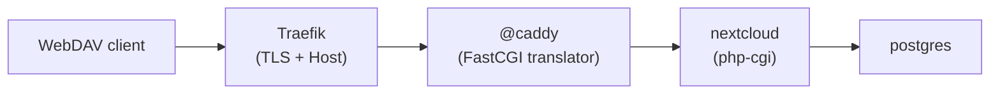

# 08 - Run Nextcloud behind Caddy

This checkpoint publishes a real FastCGI application through the shared
`@caddy` translator:

- `@caddy` matches `nextcloud.servicelasso.localhost` and forwards to a private
  FastCGI endpoint.
- `nextcloud` is the release-backed launcher. It owns PHP (`php-cgi` on Windows,
  `php-fpm` on POSIX), installs Nextcloud against `postgres`, and serves
  `remote.php` and the rest of the application.
- `postgres` provides the database.

The request path is:



```text
Traefik -> @caddy -> php-cgi (nextcloud) -> postgres
```

## Run

```powershell
npm run lesson:08
```

Install, configure and start `nextcloud` in Service Admin. The first start runs
`occ maintenance:install` and takes about a minute. Then open the allocated
`nextcloud` domain through Traefik, or use the `@caddy` web port locally with
`Host: nextcloud.servicelasso.localhost`.

## Verify WebDAV

```powershell
$caddyPort = 8080
$base = "http://127.0.0.1:$caddyPort"
$auth = 'Basic ' + [Convert]::ToBase64String(
  [Text.Encoding]::ASCII.GetBytes('admin:service-lasso'))
$headers = @{ Host = 'nextcloud.servicelasso.localhost'; Authorization = $auth }

Invoke-WebRequest "$base/status.php" -Headers $headers -UseBasicParsing
Invoke-WebRequest "$base/remote.php/dav/files/admin/lesson.txt" -Method PUT `
  -Body 'hello from caddy' -Headers $headers -UseBasicParsing
Invoke-WebRequest "$base/remote.php/dav/files/admin/lesson.txt" `
  -Headers $headers -UseBasicParsing
```

The `PUT` returns `201`, the `GET` returns the body you wrote, and a
`PROPFIND` with `Depth: 1` returns `207`.

## Windows path fix

Before the fix, a Windows `PUT` wrote the file and then never returned. The DAV
ancestor walk assumes `dirname()` eventually returns `/`. On Windows it can
return `.`, `\` or a drive root instead. The packaged service stops the walk at
those values and at a non-advancing `dirname()` in:

- `apps/dav/lib/Connector/Sabre/Directory.php`
- `lib/private/Files/Mount/Manager.php`
- `lib/private/Files/SetupManager.php`
- `lib/private/Files/Config/UserMountCache.php`

The patches live in `lasso-nextcloud/scripts/package.mjs` and are applied only
when packaging `win32`.

See [Advanced - Run Nextcloud behind Caddy](https://service-lasso.github.io/service-lasso/getting-started/advanced-run-nextcloud-behind-caddy).
